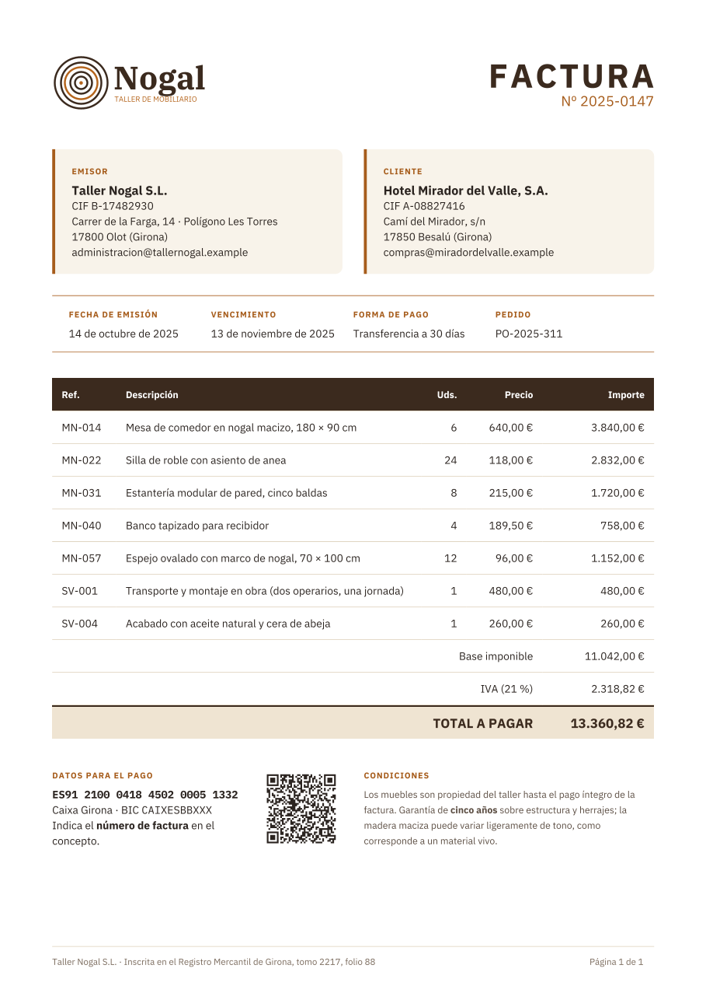
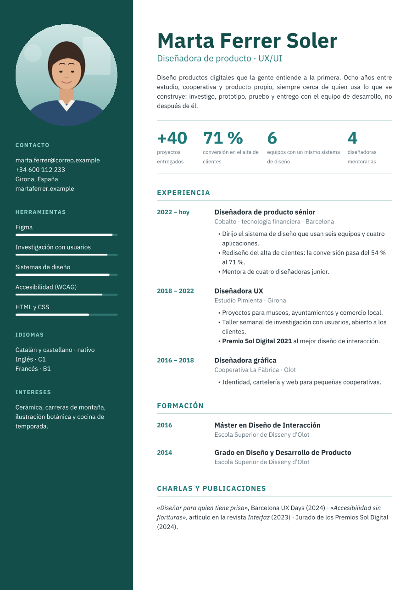
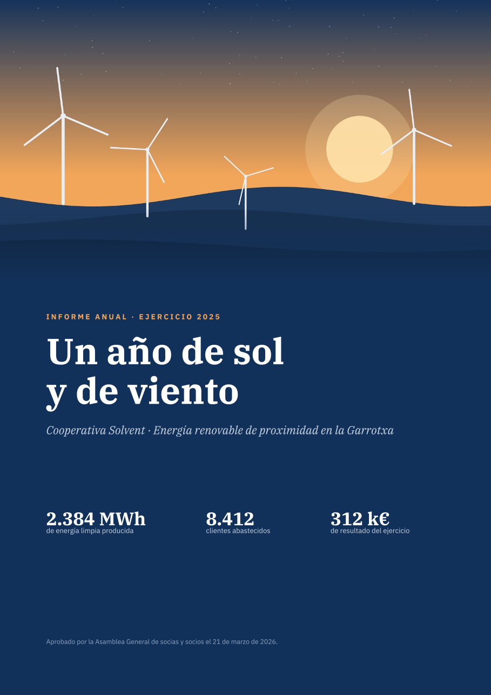
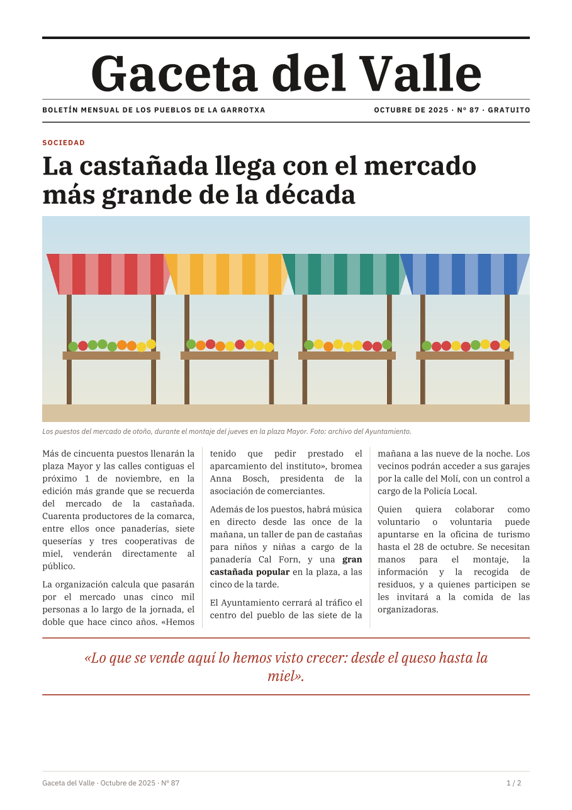
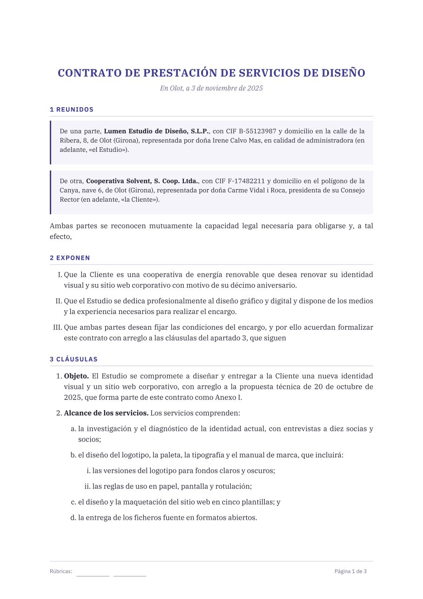
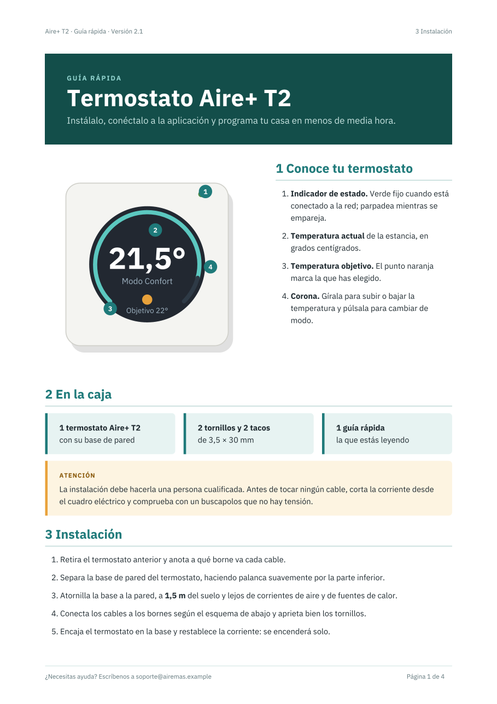
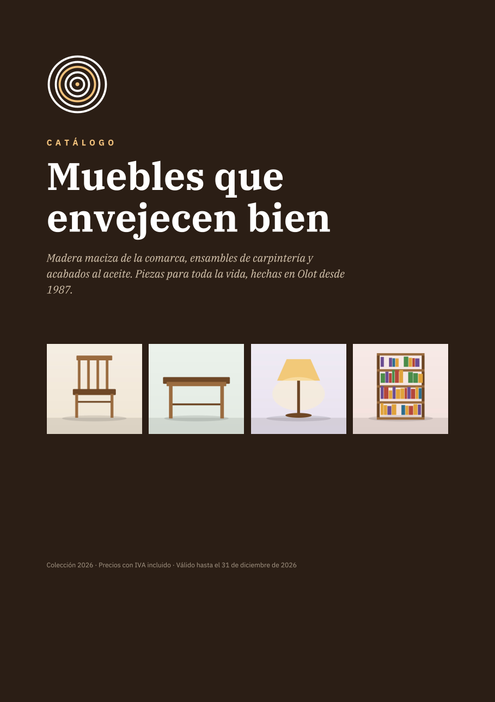
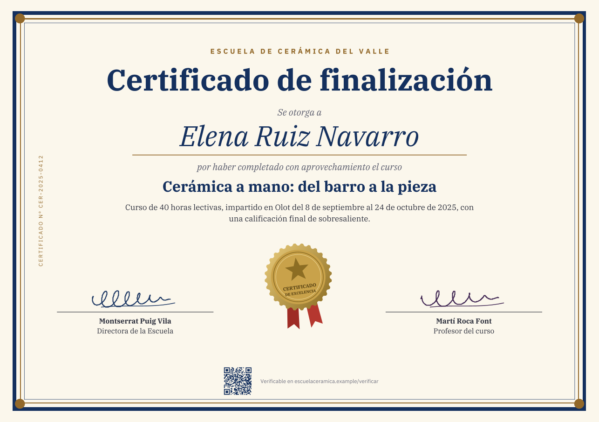
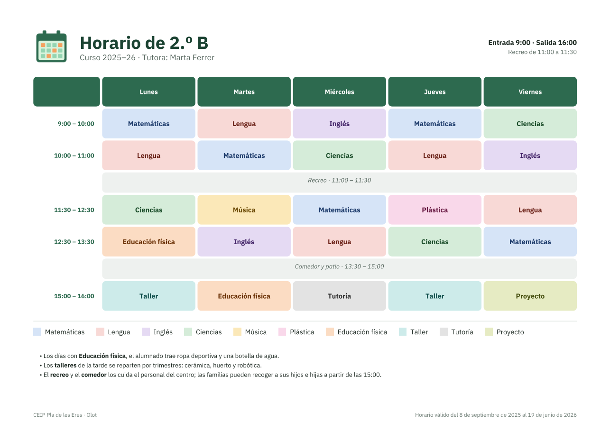

# stxt-pdf

[English](README.md) | **Español**

Motor de layout y generación de PDF a partir de documentos [STXT](https://stxt.dev). El documento describe qué hay en cada
página y cómo se ve. El motor calcula dónde va cada cosa, reparte el contenido en páginas y escribe el PDF.

```
Document (dev.stxt.pdf):
    Language: es
    Title: Informe del trimestre
    Page:
        Paper: A4
        Margin: 50
    Styles:
        For element: Document
            Typography:
                Font: IBM Plex Sans
                Size: 10
    Section:
        Heading 1:
            Text: Informe del trimestre
        Paragraph: Las ventas han crecido un 12 % respecto al trimestre anterior.
```

El PDF lleva:

- **Las fuentes incrustadas**, con los caracteres que se usan.
- **Etiquetado** para la accesibilidad: PDF/UA-1, o PDF/UA-2 si se pide.
- **Marcadores**, uno por encabezado.

**El motor es estricto.** Cada elemento solo admite las propiedades que tienen sentido en él. Ningún elemento tiene un
aspecto propio: un `Heading 1` no es más grande que un `Paragraph` si un estilo no lo dice. Lo que no tendría efecto, se
contradice o no cabe es un error con su línea.

## Documentación

| | Qué hay |
|---|---|
| [Ejemplos](#ejemplos) | Once documentos reales, con su PDF y su fuente |
| [Manual](docs/es/manual/README.md) | Cómo se escribe un documento, del primero a cada elemento. Basta con saber STXT ([stxt.dev](https://stxt.dev)) |
| [Referencia](docs/es/reference/README.md) | La regla exacta de cada comportamiento, las decisiones de diseño y la arquitectura del código |

## Ejemplos

| | Documento | PDF | Fuente |
|---|---|---|---|
| [](test/examples/01-invoice/es/output.pdf) | **Factura**: tabla con pie de totales, tarjetas con esquinas redondeadas, código en línea | [PDF](test/examples/01-invoice/es/output.pdf) (1 página) | [STXT](test/examples/01-invoice/es/input.stxt) |
| [](test/examples/02-letter/es/output.pdf) | **Carta comercial**: membrete, texto justificado con reparto equilibrado, firma | [PDF](test/examples/02-letter/es/output.pdf) (1 página) | [STXT](test/examples/02-letter/es/input.stxt) |
| [](test/examples/03-resume/es/output.pdf) | **Currículum**: rejilla a página completa, foto circular, barras de nivel | [PDF](test/examples/03-resume/es/output.pdf) (1 página) | [STXT](test/examples/03-resume/es/input.stxt) |
| [](test/examples/04-annual-report/es/output.pdf) | **Informe anual**: portada a sangre, capítulos numerados, índice automático, gráficos, dos columnas | [PDF](test/examples/04-annual-report/es/output.pdf) (7 páginas) | [STXT](test/examples/04-annual-report/es/input.stxt) |
| [](test/examples/05-newsletter/es/output.pdf) | **Boletín**: tres columnas equilibradas y con guiones, fotos recortadas, agenda en tabla | [PDF](test/examples/05-newsletter/es/output.pdf) (2 páginas) | [STXT](test/examples/05-newsletter/es/input.stxt) |
| [](test/examples/06-menu/es/output.pdf) | **Carta de restaurante**: tamaño de página propio, marco doble detrás del contenido | [PDF](test/examples/06-menu/es/output.pdf) (2 páginas) | [STXT](test/examples/06-menu/es/input.stxt) |
| [](test/examples/07-contract/es/output.pdf) | **Contrato**: cláusulas con tres niveles de numeración, referencias, firmas que no se parten | [PDF](test/examples/07-contract/es/output.pdf) (3 páginas) | [STXT](test/examples/07-contract/es/input.stxt) |
| [](test/examples/08-manual/es/output.pdf) | **Manual**: figura con números superpuestos, avisos, terminal preformateado, «véase la página», título corrido | [PDF](test/examples/08-manual/es/output.pdf) (4 páginas) | [STXT](test/examples/08-manual/es/input.stxt) |
| [](test/examples/09-catalog/es/output.pdf) | **Catálogo**: fichas en rejilla, etiqueta en diagonal, índice de productos | [PDF](test/examples/09-catalog/es/output.pdf) (5 páginas) | [STXT](test/examples/09-catalog/es/input.stxt) |
| [](test/examples/10-certificate/es/output.pdf) | **Certificado**: A4 apaisado, marcos concéntricos, sello girado, texto en vertical | [PDF](test/examples/10-certificate/es/output.pdf) (1 página) | [STXT](test/examples/10-certificate/es/input.stxt) |
| [](test/examples/11-timetable/es/output.pdf) | **Horario**: tabla con celdas separadas y redondeadas, colores por estilo | [PDF](test/examples/11-timetable/es/output.pdf) (1 página) | [STXT](test/examples/11-timetable/es/input.stxt) |

Cada ejemplo está también en inglés, con el mismo estilo, que está en su `styles.stxt`. Lo que enseña cada uno está en el [índice de los ejemplos](test/examples/README.es.md).

## Uso

Java 17 o superior.

```xml
<dependency>
    <groupId>dev.stxt</groupId>
    <artifactId>stxt-pdf</artifactId>
    <version>0.8.0</version>
</dependency>
```

```groovy
implementation 'dev.stxt:stxt-pdf:0.8.0'
```

```java
InlineNode doc = new DocumentReader().read(Path.of("informe.stxt"));
try (OutputStream out = Files.newOutputStream(Path.of("informe.pdf"))) {
    Converter.create().toPdf(doc, out);
}
```

Las fuentes y las imágenes se buscan en `resources/`. El repositorio incluye IBM Plex Sans, Serif y Mono, con licencia SIL
Open Font License. Las opciones, los errores, los límites y el uso con varios hilos están en
[Uso desde Java](docs/es/manual/common/java-usage.md).

## Desarrollo

```bash
mvn test
```

Cómo está hecho el motor: [arquitectura](docs/es/reference/architecture.md). Cómo se prueba: [pruebas](docs/es/reference/implementation/testing.md).

## Licencia

[MIT](LICENSE).
