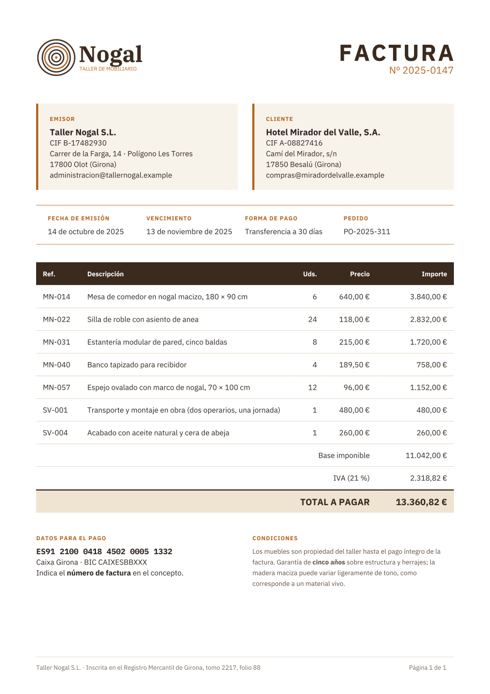
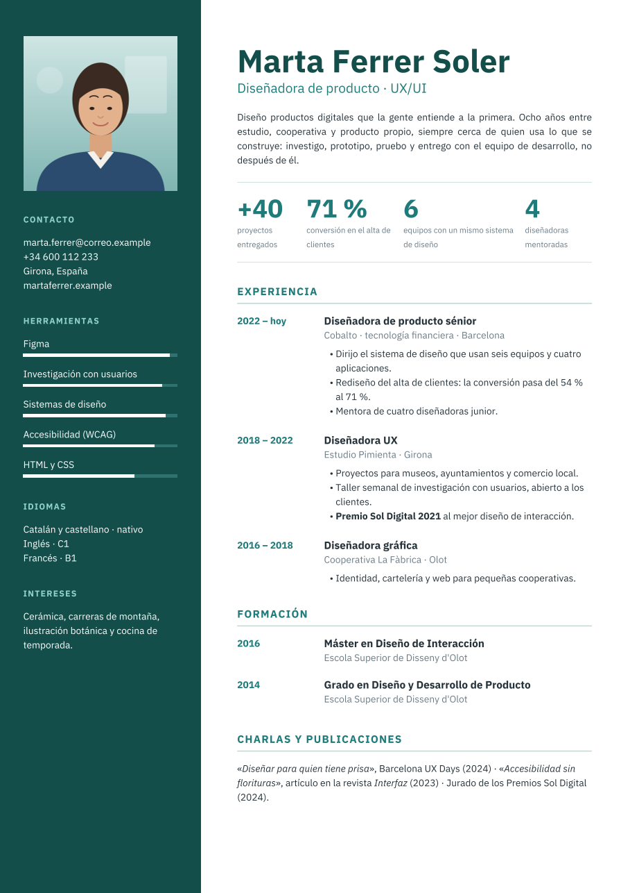
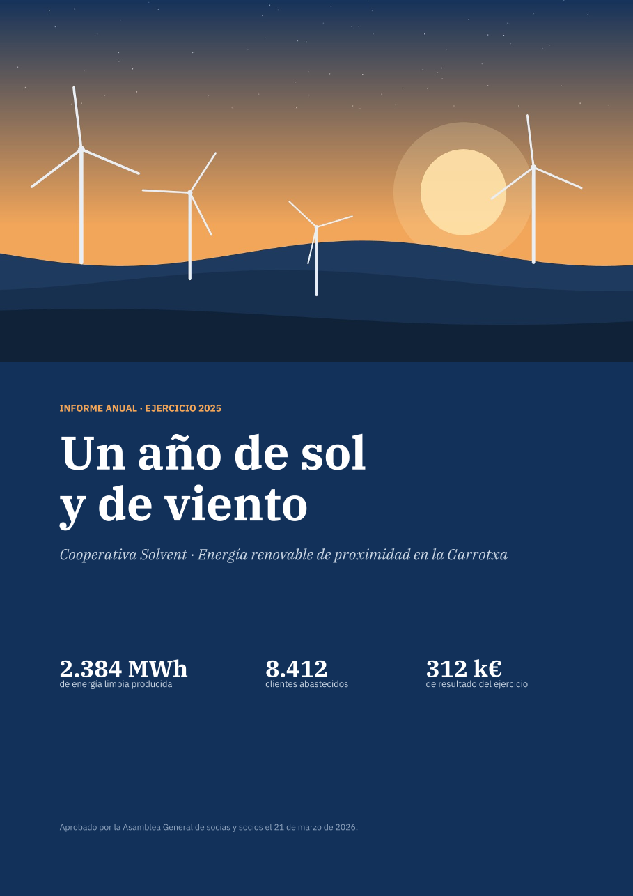
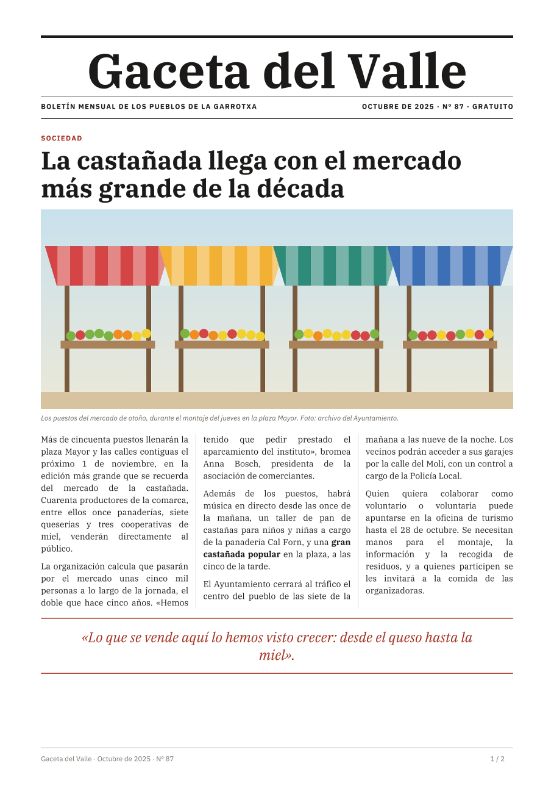
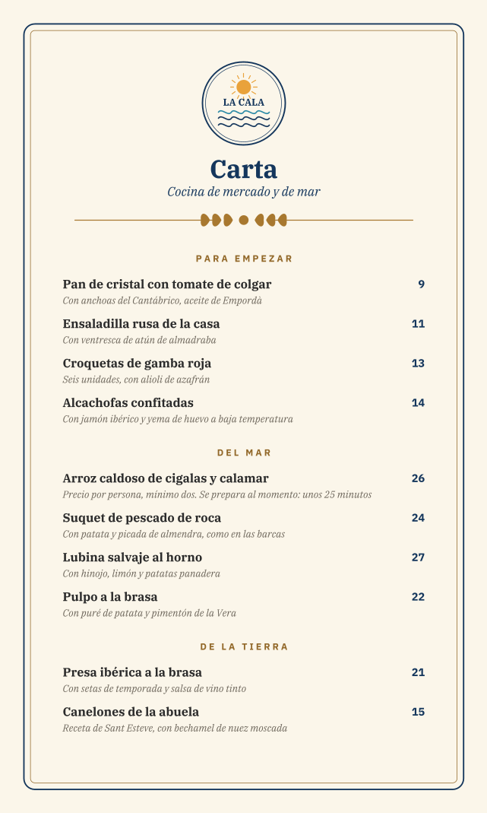
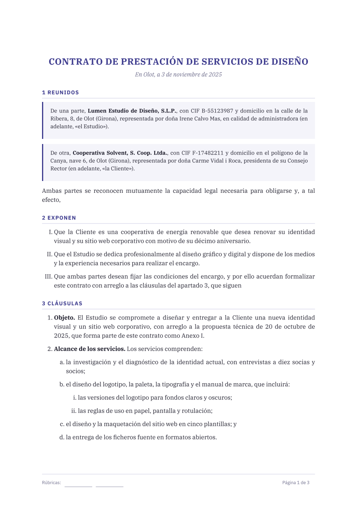
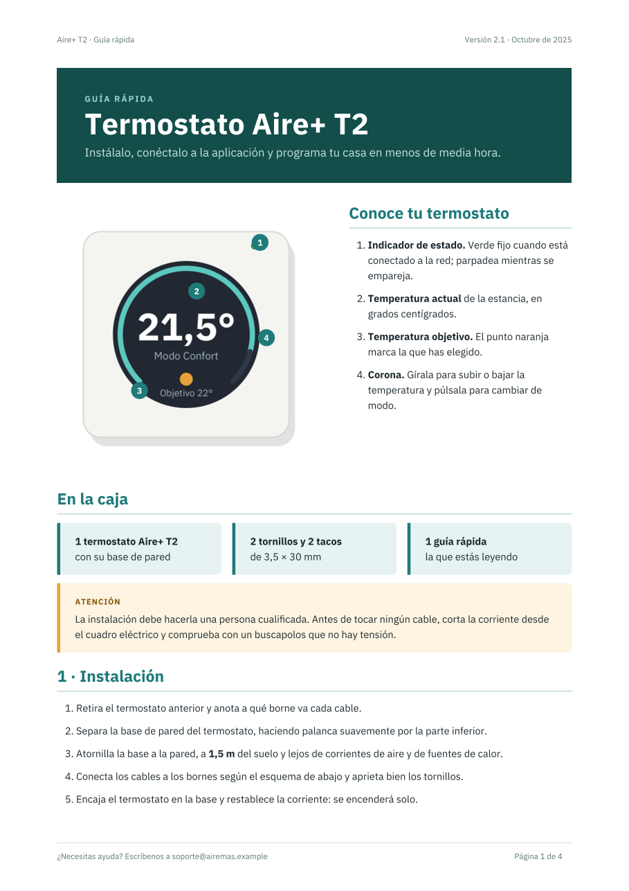
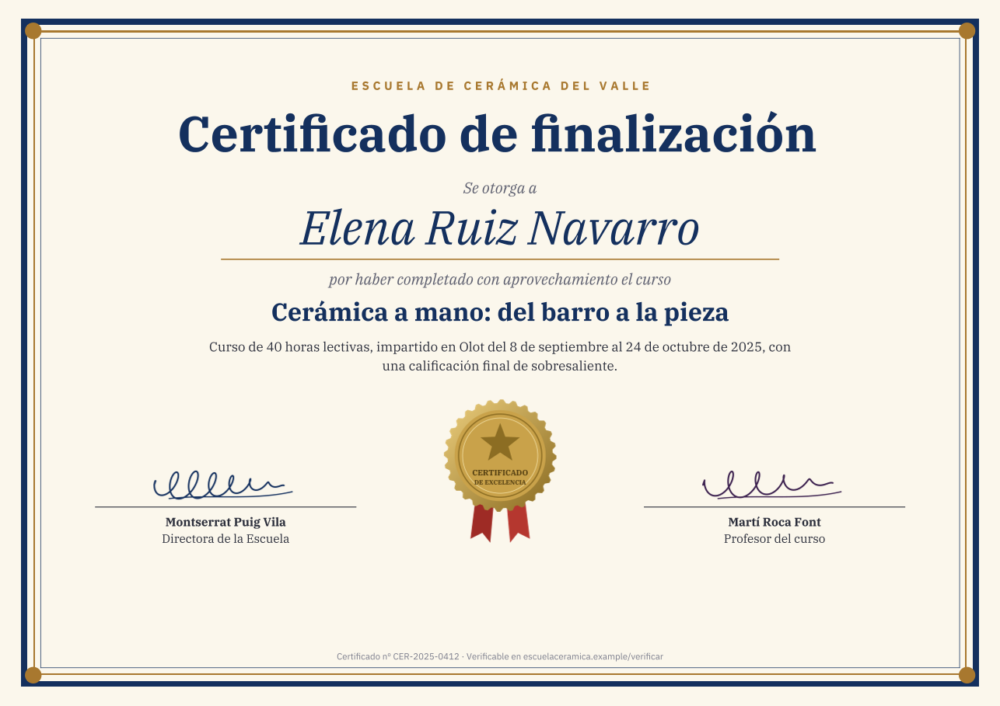

# stxt-pdf

Motor de layout y generación de PDF a partir de documentos escritos en [STXT](https://stxt.dev). Describes qué hay en
cada página y cómo se ve; el motor calcula dónde va cada cosa, reparte el contenido en páginas y escribe un PDF con las
fuentes incrustadas, accesible (PDF/UA-1, o PDF/UA-2 si se pide) y con marcadores.

```
Document (dev.stxt.pdf):
	Language: es
	Title: Informe del trimestre
	Page:
		Paper: A4
		Margin: 50
	Styles:
		For element: Document
			Typography:
				Font: IBM Plex Sans
				Size: 10
	Section:
		Heading 1:
			Text: Informe del trimestre
		Paragraph: Las ventas han crecido un 12 % respecto al trimestre anterior.
```

Todo es claro, definido y sencillo: cada elemento solo admite las propiedades que tienen sentido en él, nada tiene un
estilo oculto y lo que no tendría efecto, se contradice o no cabe es un error con su línea, nunca un resultado a medias.

## Por dónde empezar

- **¿No conoces STXT?** Es un lenguaje de texto estructurado por indentación: [stxt.dev](https://stxt.dev).
- **¿Qué se puede hacer?** Mira los [ejemplos](#ejemplos): once documentos reales, con su PDF y su fuente.
- **¿Cómo se hace?** El [manual](docs/manual/README.md) lo explica todo, de un primer documento a cada elemento.
- **¿El detalle exacto de una regla?** La [referencia](docs/referencia/README.md) es la fuente de verdad del comportamiento,
  con cada decisión de diseño y la arquitectura del código.

## Ejemplos

| | Documento | PDF | Fuente |
|---|---|---|---|
| [](test/examples/01-invoice/output.pdf) | **Factura**: tabla con pie de totales, tarjetas con esquinas redondeadas, código en línea | [PDF](test/examples/01-invoice/output.pdf) (1 página) | [STXT](test/examples/01-invoice/input.stxt) |
| [](test/examples/02-letter/output.pdf) | **Carta comercial**: membrete, texto justificado con reparto equilibrado, firma | [PDF](test/examples/02-letter/output.pdf) (1 página) | [STXT](test/examples/02-letter/input.stxt) |
| [](test/examples/03-resume/output.pdf) | **Currículum**: rejilla a página completa, foto circular, barras de nivel | [PDF](test/examples/03-resume/output.pdf) (1 página) | [STXT](test/examples/03-resume/input.stxt) |
| [](test/examples/04-annual-report/output.pdf) | **Informe anual**: portada a sangre, capítulos numerados, índice automático, gráficos, dos columnas | [PDF](test/examples/04-annual-report/output.pdf) (7 páginas) | [STXT](test/examples/04-annual-report/input.stxt) |
| [](test/examples/05-newsletter/output.pdf) | **Boletín**: tres columnas equilibradas, fotos recortadas, agenda en tabla | [PDF](test/examples/05-newsletter/output.pdf) (2 páginas) | [STXT](test/examples/05-newsletter/input.stxt) |
| [](test/examples/06-menu/output.pdf) | **Carta de restaurante**: tamaño de página propio, marco doble detrás del contenido | [PDF](test/examples/06-menu/output.pdf) (2 páginas) | [STXT](test/examples/06-menu/input.stxt) |
| [](test/examples/07-contract/output.pdf) | **Contrato**: cláusulas con tres niveles de numeración, referencias, firmas que no se parten | [PDF](test/examples/07-contract/output.pdf) (3 páginas) | [STXT](test/examples/07-contract/input.stxt) |
| [](test/examples/08-manual/output.pdf) | **Manual**: figura con números superpuestos, avisos, terminal preformateado, «véase la página» | [PDF](test/examples/08-manual/output.pdf) (4 páginas) | [STXT](test/examples/08-manual/input.stxt) |
| [](test/examples/09-catalog/output.pdf) | **Catálogo**: fichas en rejilla, etiqueta en diagonal, índice de productos | [PDF](test/examples/09-catalog/output.pdf) (5 páginas) | [STXT](test/examples/09-catalog/input.stxt) |
| [](test/examples/10-certificate/output.pdf) | **Certificado**: A4 apaisado, marcos concéntricos, sello girado, texto en vertical | [PDF](test/examples/10-certificate/output.pdf) (1 página) | [STXT](test/examples/10-certificate/input.stxt) |
| [](test/examples/11-timetable/output.pdf) | **Horario**: tabla con celdas separadas y redondeadas, colores por estilo | [PDF](test/examples/11-timetable/output.pdf) (1 página) | [STXT](test/examples/11-timetable/input.stxt) |

El estilo de cada ejemplo está en su `styles.stxt`; lo que enseña cada uno, en el [índice de los ejemplos](test/examples/README.md).

## Uso

Java 17 o superior y Maven.

```java
InlineNode doc = new DocumentReader().read(Path.of("informe.stxt"));
try (OutputStream out = Files.newOutputStream(Path.of("informe.pdf"))) {
    Converter.create().toPdf(doc, out);
}
```

Las fuentes y las imágenes se buscan en `resources/` (el repositorio incluye IBM Plex Sans, Serif y Mono, con licencia SIL
Open Font License). Opciones, errores, límites e hilos: [Uso desde Java](docs/manual/comun/uso-desde-java.md).

## Desarrollo

```bash
mvn test
```

Cómo está hecho el motor: [arquitectura](docs/referencia/arquitectura.md); cómo se prueba: [pruebas](docs/referencia/implementacion/pruebas.md).
Las ideas pendientes están en [`TODO.md`](TODO.md).

## Licencia

[MIT](LICENSE).
