# Examples

**English** | [Español](README.es.md)

Complete documents, as an author would write them, to see what the engine produces with the real fonts and images of
[`resources/`](../../resources) and **without debug outlines**. Unlike the [golden](../golden) cases, which check an
algorithm against a result worked out by hand, an example is a meaningful document, with its own content and style.

Each example is in Spanish (`es/`), the original, and in English (`en/`), its mirror: the same elements, with the texts
translated. The folder of the example has the style, shared by both languages, and one subfolder per language with the
document and its result:

| File | What it is |
|---|---|
| `styles.stxt` | The `Styles` rules and the base typography (`For element: Document`), in a [separate styles document](../../docs/en/reference/common/styles.md#separate-styles-document) passed along with the document when it is laid out. The document keeps the content and the structure, and the same style serves both languages. |
| `es/input.stxt`, `en/input.stxt` | The document. It validates against the schema and is laid out without errors. |
| `page-N.png` | One image per page of the PDF, at 110 dpi. They are versioned. |
| `expected.stxt` | The [dump](../../docs/en/reference/implementation/testing.md#the-dump) of the boxes with an `Id`, with the real metrics. |
| `output.pdf` | The PDF, to open it from the repository. It is compared byte for byte, like the images, and rewritten with `-Dexamples.update=true`. |

`ExamplesTest` runs the examples with `mvn test`: it checks that the document is read and laid out, that the dump does
not change (tolerance of 0.01 pt), that the page images are the versioned ones (except for antialiasing) and that the
PDF is, byte for byte. The PDF (tagged, with bookmarks and embedded fonts) and the new images are written to
`target/reference/examples/NN-name/en/` (or `es/`). If the PDF or an image changes, the test fails, and if the change is the intended one, it is accepted with
`-Dexamples.update=true` after looking at the images. The expected dump is not worked out by hand: it is a snapshot of
what the engine produces, reviewed by looking at the images.

```bash
mvn test -Dtest=ExamplesTest                                   # all
mvn test -Dtest=ExamplesTest -Dexamples.only=01-invoice        # one, in both languages
mvn test -Dtest=ExamplesTest -Dexamples.only=en                # all, in English
mvn test -Dtest=ExamplesTest -Dexamples.only=01-invoice/en     # one, in English
mvn test -Dtest=ExamplesTest -Dexamples.update=true            # accepts the changes: expected.stxt and page-N.png
```

The images are in [`resources/images/examples/`](../../resources/images/examples) and are generated by
[`tools/ExampleImages.java`](../../tools/ExampleImages.java) with Java2D, without third-party files
(`java tools/ExampleImages.java`). The photos and the phone screen are PNG or JPEG, and the logos, the signatures, the
seal, the charts, the emblem, the ornament, the thermostat and the wiring diagram are SVG. The fonts are IBM Plex Sans,
Serif and Mono (SIL Open Font License). Those with text (the charts, the thermostat, the phone screen, the wiring diagram
and the seal) are generated once per language, in `es/` and `en/`. The names, companies and data in the documents are
made up.

## The eleven documents

| | Document | What it shows |
|---|---|---|
| [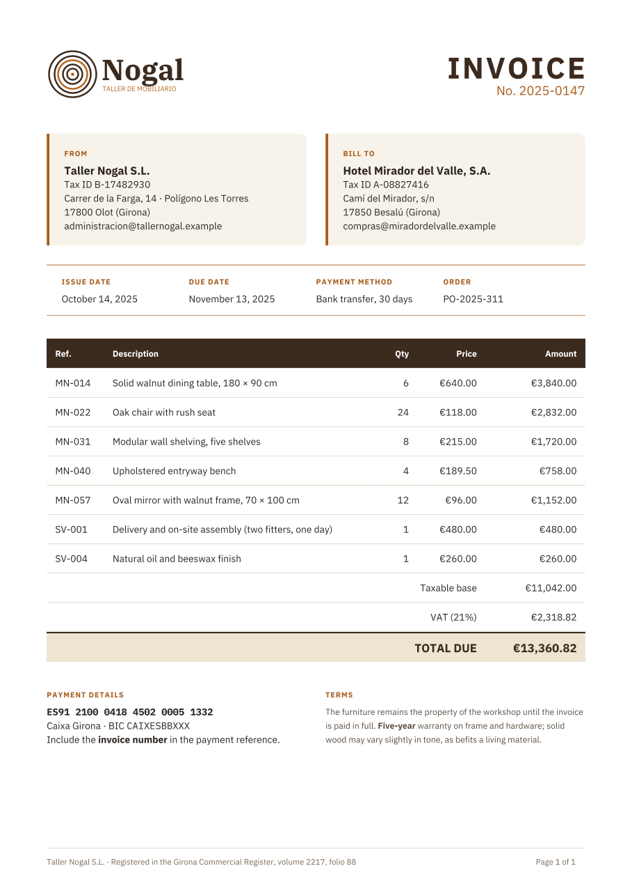](01-invoice) | **[01 · Invoice](01-invoice)**<br>One A4 page | Logo and party details in a grid, a strip of terms, a table with header, body and **totals footer**, a fixed page footer with `{page}` and `{pages}`, **clickable email addresses** (`Link: mailto:...`), and the payment details with the IBAN and the BIC as **inline code** (`Markup: markdown` and `Code font`) next to the **payment QR code** that banking apps read (a `Barcode` with its data in a `Content` block). All the styling is in `styles.stxt`. The issuer and customer cards have a colored strip on the left and **rounded corners on the right** (`Corner radius: 0 6 6 0`). |
| [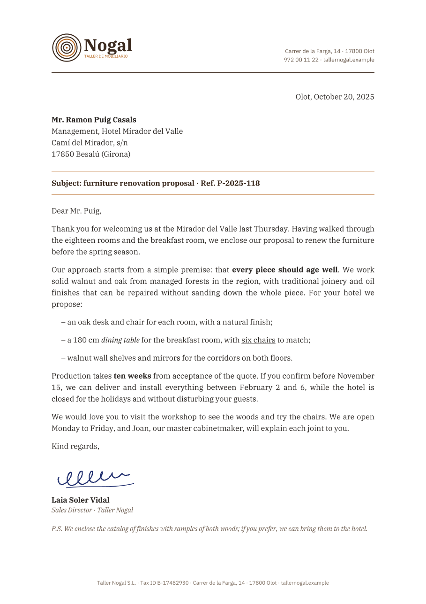](02-letter) | **[02 · Business letter](02-letter)**<br>One A4 page | Letterhead with a logo, a **Markdown** body justified with **Knuth-Plass** (`Line breaking: balanced`), bold, italic and underline within the line, a scanned signature, and the workshop's website in the footer and in the letterhead with `Link`. |
| [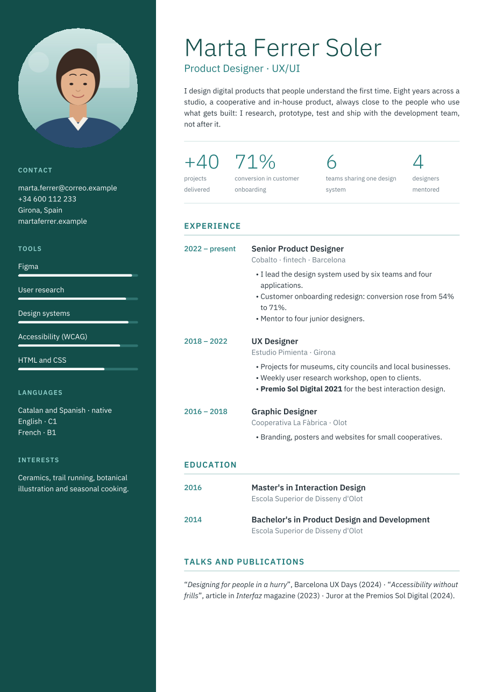](03-resume) | **[03 · Résumé](03-resume)**<br>One A4 page, no margins | Two-column grid over the **full page**, **circular** photo (`Corner radius: 50%`), skill bars with percentage widths and **rounded ends**, a timeline in a grid and figures in a `Stack`, with clickable email and website. Four **weights** of the same family (`Weight`: 300, 500, 600 and bold, 700). |
| [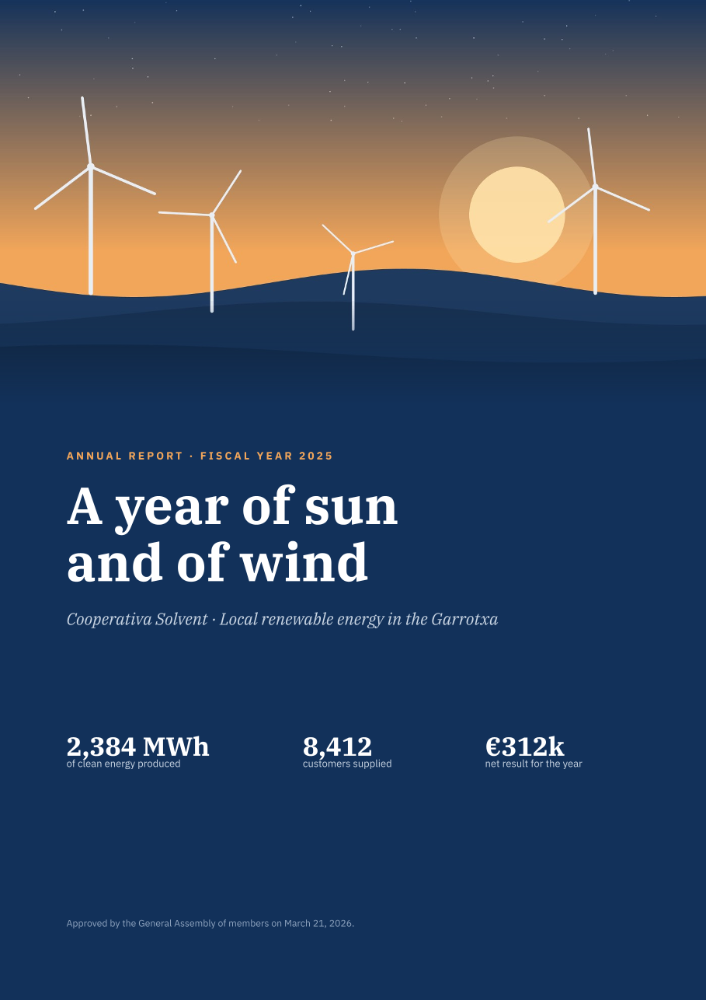](04-annual-report) | **[04 · Annual report](04-annual-report)**<br>7 A4 pages | **Full-bleed cover** with a **gradient** from transparent to blue (`linear(180, #12315A00, navy)`) that blends the photo into the panel, in a **section of its own** (`Margin: 0`, without page number or the document footer: `Page numbering: none` and `Inherit page overlays: false`) and a body numbered from 1 ("Page 1 of 6"), **numbered chapters and subsections** (`Numbered`: `1`, `1.1`, `1.2`, also in the table of contents), an **automatic table of contents** (`Table of contents`, with dot leaders, the pages computed by the engine and each entry clickable), key figures, **charts** as images, **two-column** text with a rule, a financial table with header and footer, a calendar with cells spanning several columns (`Span`), sections that start on a new page and **kerning** in all the text (`Kerning: true`), visible in the large titles of the cover. |
| [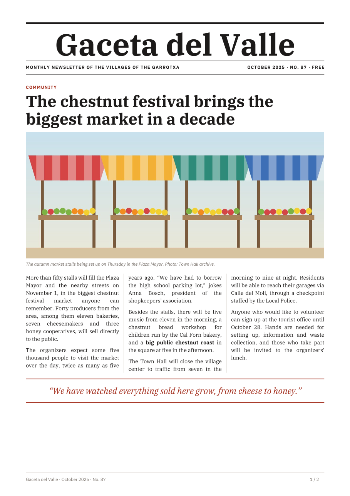](05-newsletter) | **[05 · Newsletter](05-newsletter)**<br>2 A4 pages | Newspaper look: front-page masthead, a photo cropped with `Fit: fill`, articles in **three columns** with balanced breaks and **hyphenation** (`Hyphenate: true`, except in the headings), a photo beside the text, an events table and notices in a grid, and the gazette's website in the footer. |
| [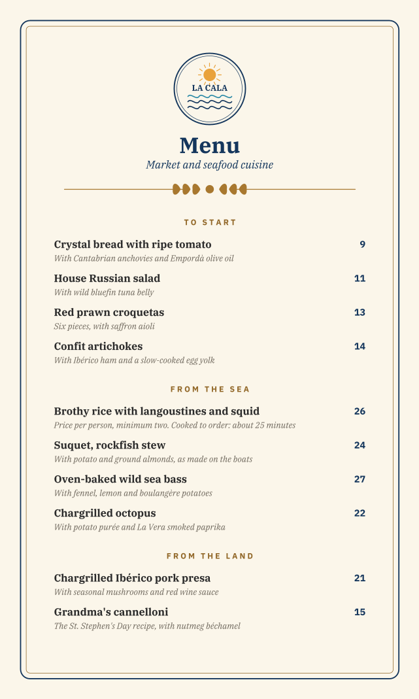](06-menu) | **[06 · Restaurant menu](06-menu)**<br>2 pages, 420 × 700 | **Custom page size**, background and double frame with **rounded corners** as a `Page overlay` with a **negative `Layer`** (behind the content on every page), dishes with prices in a `Stack`, ornaments and a centered image. |
| [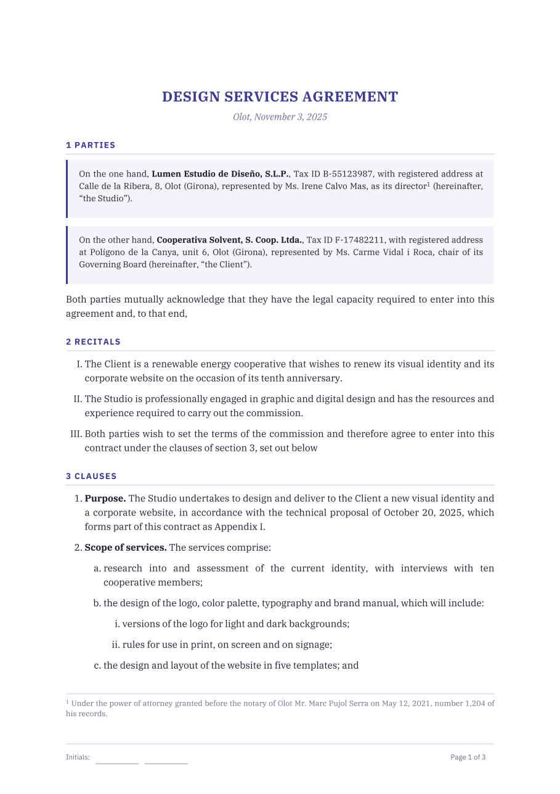](07-contract) | **[07 · Contract](07-contract)**<br>3 A4 pages | Fixed header and footer with initials, numbered sections (`Numbered`, with a `{number of: ...}` reference), `Recitals` with Roman numerals, twelve **clauses with three numbering levels** written in Markdown, an **appendix numbered in Roman numerals with its label** ("Appendix I", `Number format` and `Number label`, cited from the clauses) with the fee table, and a **signature block that is never split**. |
| [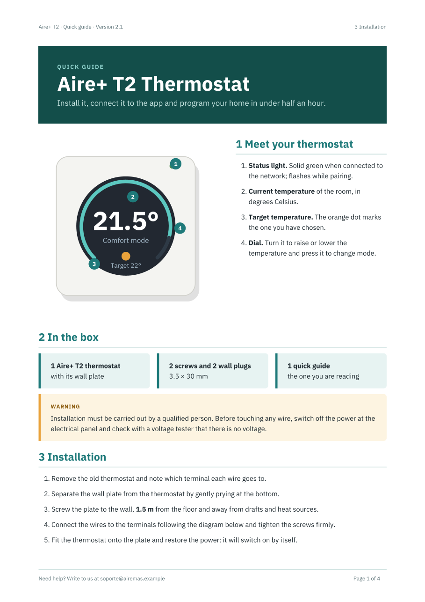](08-manual) | **[08 · Manual](08-manual)**<br>4 A4 pages | Figure with **overlaid numbers** (a `Frame` with an `Overlay` on top, each number a **circular** badge), a caption beside it, notices in color with **rounded corners** on the side opposite the strip, numbered steps, a wiring diagram, a preformatted **terminal block** (`Preformatted: true`) with **inline code** (`Code font`), specification and troubleshooting tables that refer to the diagram with **`{page of: id}`** (also inside Markdown), a **Markdown link to the specification table** (`[section {number of: ...}](#specs)`), **numbered sections and subsections** (`Numbered`: `1` to `8`, and `3.1`, `3.2`), clickable email and website, and bookmarks in the PDF. |
| [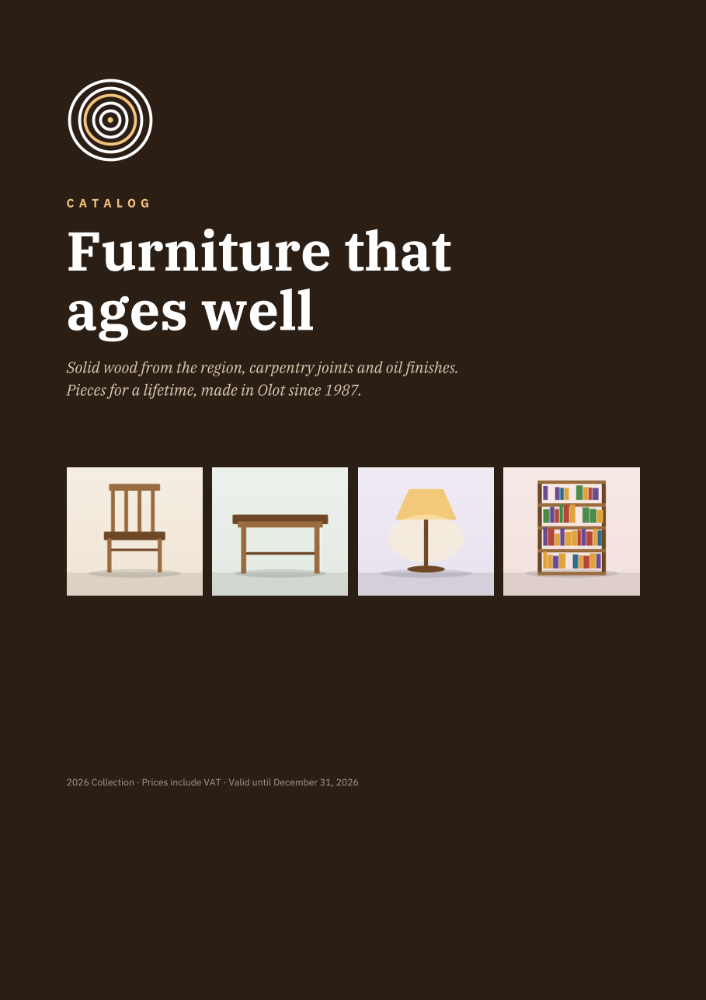](09-catalog) | **[09 · Catalog](09-catalog)**<br>5 A4 pages | Full-bleed cover, a **product index** (a two-level `Table of contents` with its indentation, its page and each entry clickable), **product cards** with rounded corners in a two-column grid, with a cropped photo (rounded at the top corners) and a "New" label **set diagonally** in the corner (an `Overlay` with `Rotate: 40`), a wood table and an order page. The paper is `Paper: A4`. |
| [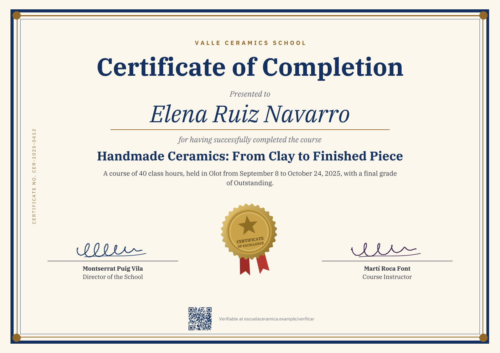](10-certificate) | **[10 · Certificate](10-certificate)**<br>One landscape A4 page | `Paper: A4` with `Orientation: landscape`. Background and **three concentric frames** with **circular** ornaments in the corners, the name as the centerpiece, two signatures and a seal with ribbons **slightly rotated** (`Rotate: -8`), all centered, the **certificate number set vertically** in the margin (a `Page overlay` rotated −90 degrees around its corner) and the verification address, clickable, in the footer, next to a **QR code** that leads to it (`Barcode`). |
| [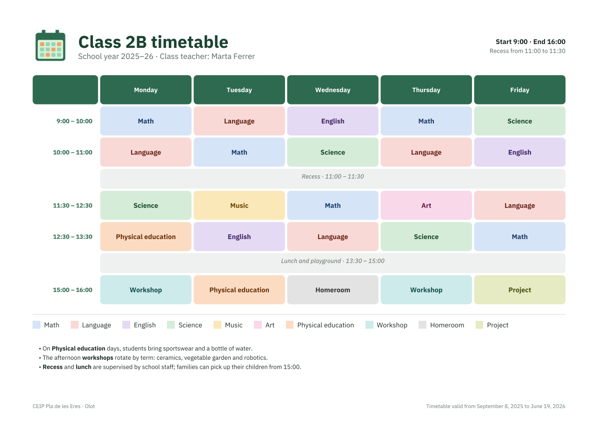](11-timetable) | **[11 · Timetable](11-timetable)**<br>One landscape A4 page | `Paper: A4` with `Orientation: landscape`. A table with cells separated by a `Gap` and **rounded** (`Corner radius` in `For element: Cell`), **colors by style**, break and lunch spanning the five days with `Span`, a legend in a `Stack` with wrapping and notes in Markdown. |

## How they are built

What several examples have in common and how it is solved:

- **A cover without header or footer** is a `Section` (examples 04 and 09), with its own `Page` (`Margin: 0`, so it is
  full-bleed without any negative `Offset`), `Page numbering: none` (it is not counted, and the first inner page is
  page 1) and `Inherit page overlays: false` (without the footer, which is a `Page overlay` of the document). A section
  always starts a page. `Pages` is for use inside a section or when there is no cover: it removes the logo from the
  first sheet of the contract (07) and the footer from the first page of the menu (06), and adds a running head from
  the second page of the newsletter (05).
- **Formatted text** is written with `Markup: markdown` (a `For element: Paragraph` rule or the `Typography` of a
  `Text`: it is inherited) for bold or italic within a sentence, and with `Markdown` when there are also lists,
  headings or tables. Without `Markup` the asterisks are literal. The clauses of the contract (07) and the steps of the
  manual (08) are `Markdown` because they are lists. The parties of the contract, the caption of the figure (08) and
  the chair's letter (04) are `Paragraph`.
- **Uppercase labels** are written as a normal phrase (`From`, `Issue date`) and a `Styles` rule turns them
  into capitals with `Case: uppercase`, almost always with a few points of `Letter spacing` (examples 01, 03, 04, 05,
  06, 07, 08, 09 and 10). The tagged PDF and the bookmarks keep what was written (`Experience` and not
  `EXPERIENCE`). Acronyms and codes (`Tax ID B-17482930`) are left as they are.
- **White space is collapsed**, except with `Preformatted: true` (or `wrap`): the terminal block with aligned columns
  in the manual (08) is a single monospaced `Text` with the spaces written out, and with `Code font` code is written
  between backticks, in a text with `Markup: markdown` (the IBAN and the BIC of the invoice, 01) or in a `Markdown`
  (the `N` terminal of the manual, 08).
- **Colors have names** in the styles of the report (04), the newsletter (05) and the contract (07): each color is
  declared once in its `styles.stxt` (`Named color: navy #12315A`) and the rules and the document write the name
  (`Color: navy`, `Border color: rule`). Changing the palette is changing those lines.
- **Tables are styled with rules** and not with a style on each cell: `For element: Header cell` styles the header
  (also in Markdown tables), `Even row cell` the zebra stripes (example 05) and `Column align` or `For column` the
  numeric columns. What belongs to a single row, such as the totals of the invoice (examples 01, 04 and 07), goes in a
  style on the `Row` (`Style: total`), which applies its rules to all its cells.
- **Links** are a property of the whole box (`Link`) or a Markdown span (`[text](target)`). A `Text` with a phone
  number and a website (examples 02 and 09) has a `Link` and is clickable as a whole, phone number included. With
  `Markup: markdown` only part of it can be linked (`[web](https://...)`).
- **The table of contents** comes from `Table of contents`: its entries are clickable, and its pages are those of
  `{page of: id}`. It lists the headings of its levels, so the title of the cover and that of the table of contents
  itself are a `Heading 1` with `In table of contents: false`, to keep them out of it (examples 04 and 09).
- **Corners, gradients and opacity.** `Corner radius` rounds the background and the border of its box, and the box
  clips the backgrounds, borders and images of what it contains along its curve
  ([The box](../../docs/en/reference/common/box.md#corners)). A color per side (`Border color`) and the strip of a
  notice (`Border: 0 0 0 3`) are combined with a radius on the opposite side only (`Corner radius: 0 4 4 0`). A
  gradient with a transparent end (04) blends an image into the color underneath without changing the image. There
  are no shadows ([The box](../../docs/en/reference/common/box.md#what-is-not-supported)): the cards of the catalog
  have a rule.
- **Rotated content** is a box with `Rotate`. The diagonal label of the catalog (09) is an `Overlay`, and the vertical
  number of the certificate (10) a `Page overlay` rotated −90 degrees around its top left corner
  (`Rotate origin: top left`), so its `Offset` is that of that corner and the box rises from it. A rotated positioned
  box does not change the layout. The seal of the certificate is an `Image` in the flow, which takes up the rectangle
  that encloses it once rotated ([Layers and rotation](../../docs/en/reference/common/layers-and-rotation.md#rotation-rotate)).
  Rotated content has to fit on the page: otherwise it is an error.
- **Vector graphics are SVG**: the logos (01, 02, 07, 09), the signatures (02, 07, 10), the seal (10), the three charts
  of the report (04), the emblem and the ornament of the menu (06), and the thermostat and the wiring diagram of the
  manual (08) are an `Image` with an `.svg` from `images/`: they stay sharp at any size and the PDF carries them as
  paths and gradients and not as pixels. Their text uses the IBM Plex fonts of `fonts/` (the engine substitutes none),
  but it is drawn as outlines: it cannot be selected. The photos and the phone screen (08) are still PNG or JPEG.
- **Paper has a name**: the A4 documents say `Paper: A4` (and the landscape ones, 10 and 11, also
  `Orientation: landscape`) instead of writing its size. The restaurant menu (06) is the only one with a custom size
  (420 × 700), still written with `Width` and `Height`. The full-bleed covers of the annual report (04) and of the
  catalog (09) measure the whole sheet in millimeters: `Width: 210mm` and `Height: 297mm`.
